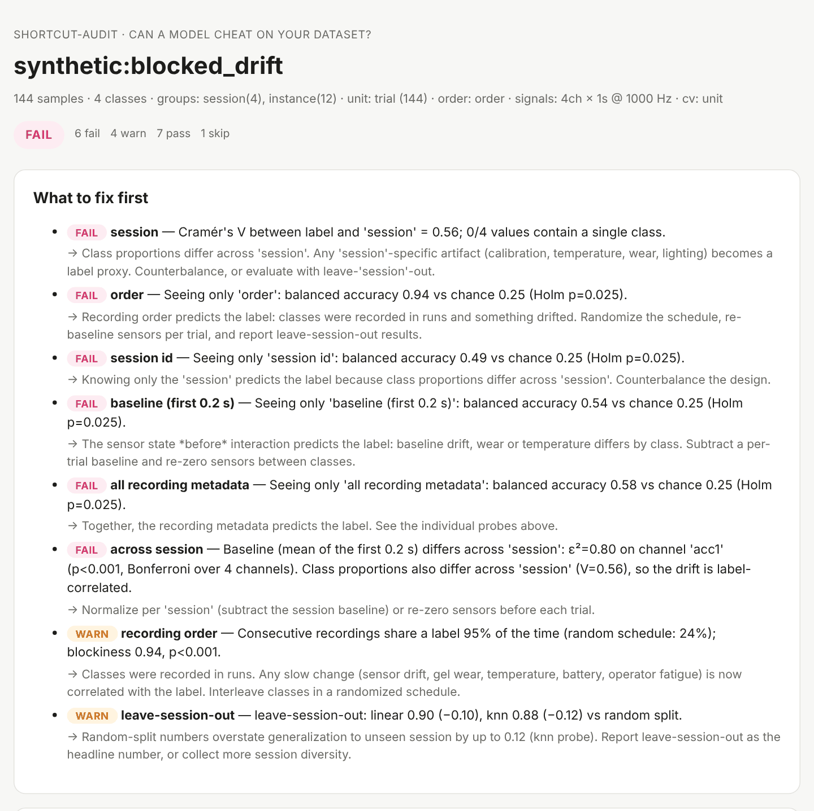

# shortcut-audit

**Can a model cheat on your dataset?**

[](https://github.com/WayneUSC/shortcut-audit/actions/workflows/ci.yml)

[](LICENSE)

Sensor and robot datasets fail quietly. Classes get recorded on different days while the sensor drifts. Every
object has its own resonance, so the model learns *which box* instead of *what's inside*. Overlapping windows
from one trial land on both sides of a random split. The model scores 98% and nothing you measured is real.

Dataset checkers such as [lerobot-doctor](https://github.com/jashshah999/lerobot-doctor),
[lerobot-dataset-lint](https://github.com/easyrider11/lerobot-dataset-lint) and the FiftyOne LeRobot plugin ask
**"is my data broken?"** — NaNs, dropped frames, bad timestamps. `shortcut-audit` asks the next question:
**"is my data cheat-able?"** It trains deliberately simple probes on things that *should not* predict your label
(recording order, session, the sensor's resting level, the robot's starting pose) and on split protocols that
remove the easy way out, then tells you what to fix.

<picture>
  <source media="(prefers-color-scheme: dark)" srcset="docs/assets/report-dark.png">
  
</picture>

## Install

```bash
pip install "git+https://github.com/WayneUSC/shortcut-audit"            # core
pip install "shortcut-audit[lerobot] @ git+https://github.com/WayneUSC/shortcut-audit"  # + LeRobot / Hub
```

Python 3.9+, depends on NumPy, SciPy, scikit-learn and pandas. Runs on a laptop CPU in seconds to a minute.

## Try it in 30 seconds

```bash
shortcut-audit demo --scenario all --html report.html
```

This audits four synthetic "shake a box, guess what's inside" datasets where the shortcut is planted on purpose
(see [What it catches](#what-it-catches)).

## Audit your own data

### Python

```python
import shortcut_audit as sa

ds = sa.AuditDataset(
    y=labels,                       # (N,)       what the model predicts
    signals=windows, fs=1000,       # (N, C, T)  raw windows — or features=(N, F)
    meta={"session": session, "object": obj, "trial": trial, "t": t},
    groups=["session", "object"],   # factors you claim to generalize across
    unit="trial",                   # windows cut from one recording are not independent
    order="t",                      # recording order or timestamp
)
report = sa.audit(ds, nested=["object"], baseline_s=0.2, cross=("session", "object"))

print(report.to_text())
report.to_html("audit.html")        # single self-contained page, light/dark
report.to_json("audit.json")        # for CI and notebooks
```

### Command line (`.npz`, `.csv`, `.tsv`, `.parquet`)

```bash
# .npz with arrays: signals (N,C,T) or features (N,F), y, fs, and any 1-D metadata arrays
shortcut-audit run windows.npz --label y --groups session,object --nested object \
    --unit trial --order t --baseline-s 0.2 --cross session,object --html audit.html

# a table with one row per sample; every other numeric column is a feature
shortcut-audit run features.csv --label material --groups subject --order timestamp --split split
```

Exit code is `1` when the verdict is FAIL (`--fail-on warn` to be stricter), so it drops into CI next to your
training job.

### LeRobot datasets (local or Hugging Face Hub)

```bash
shortcut-audit lerobot user/my_tactile_dataset --html audit.html
shortcut-audit lerobot ./my_dataset --episode-meta sessions.csv --groups operator
```

Reads `meta/` and `data/` parquet only — videos are never downloaded. At the episode level it asks:

- **Can the task be guessed before the robot moves?** If the first frame of `observation.state` predicts the task,
  a policy can read the task from proprioception and ignore the instruction.
- **Do tactile / force / effort channels start from a task-correlated level?** Resting level of every non-visual
  sensor in the first frames, probed against the task and tracked over the recording campaign.
- **Can a blind replay explain the actions?** The time-normalized mean trajectory of the *other* demos of the same
  task, replayed with no observations, against each held-out episode.
- **Were tasks recorded in blocks? Are episodes duplicated?**

## The audits

| Audit | Question | How |
|---|---|---|
| **confound** | Is the label entangled with how or when data was recorded? | Bias-corrected Cramér's V for label × each grouping factor; blockiness of the recording schedule (per recording, not per window) with a permutation p-value. |
| **nuisance** | Can a model that sees only irrelevant information beat chance? | k-NN probes on recording order, session id, pre-contact baseline, user nuisance columns, adapter blocks; cross-validated balanced accuracy; label permutation test **at the recording level**; Holm correction across probes. |
| **protocol** | How much does accuracy depend on having seen the same session / object / recording? | Linear and k-NN reference probes under random, leave-recording-out, leave-group-out and joint leave-*A*-and-*B*-out splits. Reports the gap. |
| **leakage** | Does the test set contain recordings, groups or near-copies seen in training? | Unit/group overlap across the split, nearest-neighbour near-duplicate rate against independent pairs, exact duplicates (with conflicting labels). |
| **drift** | Does the sensor's resting level move between sessions or over time? | Kruskal–Wallis ε² across sessions, Spearman trend over time, Bonferroni over channels; escalated when the session is also label-imbalanced. |
| **spectral** | Which frequency bands carry the label — and is it only the DC offset? | Octave band-power sweep with a linear probe, offset-only probe, offset ablation. |
| **replay** | Can a blind open-loop replay explain the recorded actions? | Leave-one-episode-out time-normalized template, R² on held-out actions. |

Every finding is **PASS / WARN / FAIL / SKIP** with the numbers behind it and a concrete fix. Method details and
how to read each number: [docs/audits.md](docs/audits.md).

## What it catches

Synthetic shaking-box datasets (4 contents × 4 sessions × 3 boxes × 3 trials, four 1 kHz accelerometers), each
with one planted failure. Reproduce with `python examples/planted_shortcuts.py`.

| Scenario | Planted problem | Verdict | Key evidence |
|---|---|---|---|
| `clean` | none | **PASS** | 17/17 checks pass; every probe at chance |
| `blocked_drift` | two classes per day, recorded in runs, sensor offset drifts | **FAIL** | label × session V = 0.56; recording order alone → 0.94 balanced accuracy (chance 0.25); pre-contact baseline alone → 0.54; DC offset alone → 0.68 |
| `instance_memorization` | each box has a unique resonance, content signal weak | **FAIL** | random split 0.99 → leave-box-out 0.33 |
| `window_leakage` | overlapping windows split at random | **FAIL** | 102 trials straddle the split; leave-trial-out −0.18 for k-NN |

The `clean` scenario matters as much as the others: the audit is only useful if it stays quiet when nothing is
wrong. Under pure noise the nuisance probes fire in ≤ 2 of 12 random datasets (tested in CI).

## Design choices

- **Probes, not models.** k-NN and linear probes are fast enough for real permutation tests and simple enough that
  a high score means the information is *there*, not that a big model found it.
- **Permutations respect recordings.** When windows are cut from trials, labels are permuted between trials, not
  between windows — otherwise p-values are far too small.
- **Folds never depend on labels** in grouped protocols, so every permutation is evaluated on identical folds.
- **Holm correction** across probes, **Besag–Clifford early stopping** for clearly-null probes, and a permutation
  budget large enough that Holm can actually reach α.
- **Two reference probes** in the protocol audit: linear (generalizable structure) and k-NN (a memorizer — the most
  sensitive to near-copies).

## Scope

The audits probe the metadata and features you give them. A PASS means these probes found nothing, not that no
shortcut exists; a FAIL means the information is available to a model, not that your model uses it. Video frames
are not analysed (pair it with a visual dataset tool for that). Thresholds are configurable (`AuditConfig`).

## Part of a small toolkit for trustworthy robot data

| | Question |
|---|---|
| **shortcut-audit** | Can a model cheat on your dataset? |
| [**anchorsync**](https://github.com/WayneUSC/anchorsync) | Are your sensor streams actually on the same clock? |
| [**rollout-stats**](https://github.com/WayneUSC/rollout-stats) | Is your policy's improvement real, or 20 lucky rollouts? |

## Citation

```bibtex
@software{chen_shortcut_audit_2026,
  author = {Chen, Wen},
  title  = {shortcut-audit: shortcut and leakage audits for sensor and robot datasets},
  year   = {2026},
  url    = {https://github.com/WayneUSC/shortcut-audit}
}
```

## License

Apache-2.0
